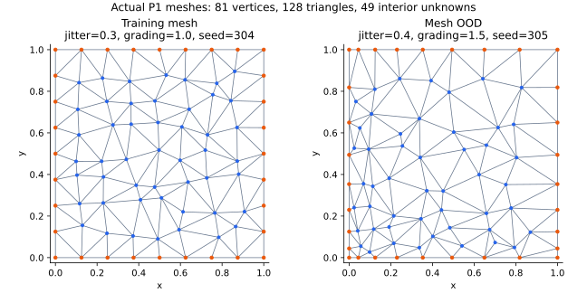

# Neural AMG for unstructured triangular P1 FEM



Branch: **`neural-amg`**. This branch uses **P1 FEM on unstructured triangular
meshes exclusively**. Q1, structured-triangle assembly and the old geometric/CNN
runners have been removed from this branch. Their history remains available in
[`residual-u-net-teacher`](https://github.com/slwjackie/adaptive-multigrid/tree/residual-u-net-teacher).

[한국어 안내](README_KR.md) · [Runbook](docs/neural_amg.md) ·
[P1 formulation and verification](docs/p1_fem.md)

## Discretization and solver

The PDE is `-div(K(x,y) grad(u)) = f` on the unit square, with SPD diffusion
tensors. Interior point locations are perturbed using a recorded mesh seed,
then Delaunay triangulated. Vertex numbering is permuted; connectivity is not a
fixed square split. Every element has three vertices and linear shape functions.
The study assembles the physical source **f=1**, with **u=0 on the boundary**.

| Component | Implementation |
| --- | --- |
| Mesh | Seeded unstructured Delaunay triangles; jitter and optional spatial grading |
| FEM | Continuous scalar P1; actual triangle Jacobians and basis gradients |
| Integration | Positive seven-point, degree-five triangle quadrature for stiffness and load |
| Boundary conditions | Dirichlet elimination; low-level FEM API also supports nonzero values |
| Coarse nodes C | Classical Ruge–Stüben AMG on each actual level matrix |
| Support S | Classical interpolation pattern, checked to be at most two A-graph hops |
| Teacher | BAMG+EM optimization on fixed C/S |
| Network | Three A-graph attention layers → sparse fine–coarse attention → signed edge head |
| Constraints | Coarse injection, reference row sums, signed row-L1 cap |
| Multigrid | R=Pᵀ, Ac=PᵀAP, weighted Jacobi pre/post twice, terminal sparse LU |
| Training | Teacher weight/action supervision, then multicycle residual fine-tuning |
| Model selection | Validation failures first, measured setup-plus-solve time second |
| Inference | During hierarchy setup only; sparse arithmetic during every V-cycle |

`original` input features are the default. `row9` and `symmetric9` remain optional
feature experiments; neither changes the P1 discretization. The three-hop range
belongs to the A encoder; cross-attention can make the overall receptive field
larger. P remains confined to S. The current implementation uses CPU FP64.

## Install and run

Use Linux/macOS or Lenovo Ubuntu/WSL, from the repository root:

```bash
python3 -m venv .venv
source .venv/bin/activate
python -m pip install -e '.[dev]'
python scripts/run_neural_amg.py train \
  --config configs/neural_amg_smoke.json --run-dir artifacts/neural_amg_p1_smoke
python scripts/run_neural_amg.py freeze \
  --config configs/neural_amg_smoke.json --run-dir artifacts/neural_amg_p1_smoke
python scripts/run_neural_amg.py evaluate \
  --config configs/neural_amg_smoke.json --run-dir artifacts/neural_amg_p1_smoke
```

Use a **new run directory**. Protocol `neural-amg-p1-study-v2` rejects earlier
Q1 runs/checkpoints. Arbitrary preassembled A/b manifests are no longer a study
input: every study operator is assembled here from its recorded P1 mesh.

The research config provides 560 training, 280 validation and 280 final operators
from seven diffusion families, plus six OOD groups. `ood_topology` varies the
coefficient field; the separate `ood_mesh` uses different jitter and spatial
grading. Mesh coordinates, triangles, boundary flags, the interior-DOF map and
checksums are saved with every assembled operator. Final/OOD meshes are generated
only after the checkpoint and protocol have been frozen.

See the [runbook](docs/neural_amg.md) for research training, resume and evaluation.
Research-scale training and speed superiority have not been established by tests.

## Code and validation

- [fem.py](src/neural_amg/fem.py): mesh, P1 assembly, boundary elimination and error norms.
- [data.py](src/neural_amg/data.py): diffusion fields, split specifications and mesh seeds.
- [structure.py](src/neural_amg/structure.py): classical C/S and support checks.
- [model.py](src/neural_amg/model.py): graph features, attention and signed P.
- [teacher.py](src/neural_amg/teacher.py): BAMG+EM teacher.
- [solver.py](src/neural_amg/solver.py): sparse runtime and differentiable MG.
- [study.py](src/neural_amg/study.py): training, mesh provenance, freeze and evaluation.

Run `python -m pytest -ra`. Tests cover exact element matrices/loads, affine patch
reproduction, boundary elimination, mesh refinement (L2 order two and H1 order
one), SPD assembly for all seven families, multilevel gradients, and resume/freeze.
Discontinuous material interfaces may cut triangles; their quadrature integrals
are approximations, not an interface-fitted accuracy claim.
