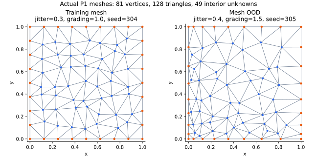

# 비정렬 삼각형 P1 FEM 기반 Neural AMG



현재 **`neural-amg` 브랜치는 FEM P1 비정렬 삼각형 이산화만 사용한다.**
Q1, 정렬 삼각형 조립, 이전 geometric/CNN 실행 경로는 이 브랜치에서 제거했다.
이전 연구 코드는 [`residual-u-net-teacher`](https://github.com/slwjackie/adaptive-multigrid/tree/residual-u-net-teacher)와 Git 이력에 남아 있다.

[실행 문서](docs/neural_amg.md) · [P1 수식·검증](docs/p1_fem.md) · [영문 README](README.md)

## 실제 계산 흐름

1. Seed에 따라 내부 점 위치를 교란하고 Delaunay 삼각분할로 비정렬 mesh를 만든다.
   삼각형은 실제 좌표와 연결 정보로 저장하며, 정사각형을 고정 대각선으로 자르지 않는다.
2. 각 삼각형의 선형 형상함수 기울기를 계산해 P1 FEM 강성행렬을 조립한다.
3. 연구 데이터는 물리적 소스 `f=1`을 적분해 하중벡터를 만들고 `u=0` Dirichlet 경계를 제거한다.
4. Classical AMG가 각 level의 실제 A에서 coarse 노드 C와 interpolation support S를 정한다.
5. BAMG+EM teacher로 graph attention 모델을 지도학습하고, 실제 MG 잔차로 fine-tuning한다.
6. 생성한 P로 `R=Pᵀ`, `Ac=PᵀAP`를 구성한다. NN 추론은 setup에서만 수행한다.

| 항목 | 설정 |
| --- | --- |
| 이산화 | 비정렬 삼각형 P1 FEM만 허용 |
| 공간 적분 | 양의 가중치를 가진 7점 삼각형 적분, 5차 다항식까지 정확 |
| Attention | A 그래프 3층 + sparse fine–coarse cross-attention + signed edge head |
| P 제약 | Coarse injection, 기준 P 행합 유지; L1 hard cap 제거 |
| 상쇄 억제 | 정규화된 상쇄량 제곱의 평균; teacher·지도학습·fine-tuning 각각 η=0.1 |
| 수치 검사 | P·Ac·LU 검사 및 실제 첫 V-cycle 잔차 검사, 문제 계층에서 직접 LU 풀이 |
| Smoother | Weighted Jacobi pre/post 각 2회 |
| 입력 특징 | `original` 기본, `row9`·`symmetric9` 선택 실험 |
| 계산 환경 | CPU FP64 |
| 연구 데이터 | TRAIN 560 / validation 280 / final 280 + 6종 OOD |
| Mesh OOD | 별도 `ood_mesh`: jitter와 공간 grading 변화 |

격자 크기 `n`은 초기 점 밀도를 정하며 기본 내부 미지수는 `n²`개다.
점의 실제 좌표와 Delaunay 연결은 mesh seed에 따라 달라진다. Solver와 NN은
행렬을 정렬 격자 이미지로 reshape하지 않는다. `ood_topology`는 계수 분포 형상의
변화이며, mesh의 변화는 `ood_mesh`로 따로 평가한다.

## 실행과 재개

```bash
python3 -m venv .venv
source .venv/bin/activate
python -m pip install -e '.[dev]'
python scripts/run_neural_amg.py train \
  --config configs/neural_amg_smoke.json --run-dir artifacts/neural_amg_p1_v3_smoke
python scripts/run_neural_amg.py freeze \
  --config configs/neural_amg_smoke.json --run-dir artifacts/neural_amg_p1_v3_smoke
python scripts/run_neural_amg.py evaluate \
  --config configs/neural_amg_smoke.json --run-dir artifacts/neural_amg_p1_v3_smoke
```

**새 출력 폴더를 사용하는 `neural-amg-p1-study-v3` 실험이다.** 모든 연구 행렬은
저장된 삼각형 mesh에서 P1으로 조립되며, 좌표·연결·경계·내부 DOF 배열과 해시를
함께 보존한다. Final/OOD mesh는 freeze 후 생성한다.

## Lenovo의 기존 checkpoint를 활용하기

기존 WSL 환경의 라이브러리 버전을 유지하면서 아래 명령을 실행한다.

```bash
cd /mnt/c/Users/user/Desktop/adaptive-multigrid-neural-amg
source .venv/bin/activate
git status --short
git fetch origin
git switch neural-amg
git pull --ff-only origin neural-amg
python -m pip install --no-deps -e .

export OMP_NUM_THREADS=1
export OPENBLAS_NUM_THREADS=1
export MKL_NUM_THREADS=1
export PYTHONUNBUFFERED=1
set -o pipefail
mkdir -p logs

OLD_RUN="artifacts/neural_amg_p1_560_seed6101_lenovo_teacher_l1_fix"
RUN="artifacts/neural_amg_p1_560_seed6101_lenovo_cancellation"
CFG="configs/neural_amg_research.json"
python scripts/start_neural_amg_cancellation.py \
  --run-dir "$OLD_RUN" --output-dir "$RUN" --config "$CFG"
python -u scripts/run_neural_amg.py train \
  --config "$CFG" --run-dir "$RUN" --resume \
  2>&1 | tee logs/research_train_cancellation.log
```

이 명령은 d5257e2의 기존 v2 checkpoint와 데이터·환경·소스 해시를 검증하고
새 폴더에 최신 학습 가중치를 가져온다. 기존 11,060회 이력은 출처로 기록하며,
새 fine-tuning은 **8 epoch 전체(560 × 8 = 4,480 case)**를 실행한다. Optimizer와
validation의 best 선택을 새로 시작하고, 이전 teacher label은 복사하지 않는다.
초기 validation도 새 목적함수·solver 조건에서 다시 측정한다. 원래 폴더는 보존된다.

중단 후에는 초기화 스크립트를 반복하지 않고, 위 `train --resume` 명령의 로그를
`tee -a`로 바꿔 이어간다. 학습 완료 후 다음 명령으로 freeze와 final/OOD를 수행한다.

```bash
python scripts/run_neural_amg.py freeze --config "$CFG" --run-dir "$RUN"
python -u scripts/run_neural_amg.py evaluate \
  --config "$CFG" --run-dir "$RUN" \
  2>&1 | tee logs/research_evaluate_cancellation.log
```

평가 중단 후에는 `evaluate`에 `--resume`을 추가하고 `tee -a`를 사용한다.
새 터미널에서는 환경 활성화, thread 설정, `RUN`·`CFG` 정의를 다시 실행한다.

η=0.1은 우선 적용하는 하이퍼파라미터이며 수렴 보장이 아니다. Teacher는 상쇄 벌점을
포함한 문제를 CG/ADMM으로 풀고 유한한 반복 예산과 수렴 여부를 report에 기록한다.
기본 잔차 guard는 각 계층의 실제 첫 V-cycle에서 잔차가 10배를 초과해 증가하거나
비정상 값이 생기면 작동한다. `hierarchy.first_cycle_max_growth`로 배수를 설정한다.
추가 진단 벡터는 만들지 않으며, 학습 손실의 기존 random probe는 계속 사용한다.

문제 계층에서 직접 LU 풀이로 끝내는 동작은 앞쪽 NN 보간을 유지한다. 큰 계층에서
직접 풀면 시간과 메모리 부담이 커질 수 있고, 그 비용은 측정 시간에 포함한다.
Guard 발생 정보는 학습 로그 및 평가 결과의 `guard_events`에 저장한다.

처음부터 v3 teacher label을 생성해 15 epoch 지도학습과 8 epoch fine-tuning을
수행하는 별도 실행, smoke, 중단 후 재개 명령은 [실행 문서](docs/neural_amg.md)에 있다.
단위 테스트와 smoke는 실행·수치 검증이며, v3의 560개 연구 학습과 classical AMG
대비 속도 우위는 실제 연구 실행으로 평가해야 한다.
