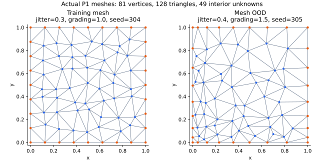

# 비정렬 삼각형 P1 FEM

구현: [`fem.py`](../src/neural_amg/fem.py), [`data.py`](../src/neural_amg/data.py).
이 브랜치의 유일한 이산화 식별자는 `p1_unstructured`다.

## Mesh

영역은 단위 정사각형이다. 초기 내부 점 간격을 $h=1/(n+1)$로 두고 각 좌표를
$[-\text{jitter}\,h,\text{jitter}\,h]$ 범위에서 독립적으로 교란한다. 양의 jitter가
필수이며 기본값은 0.3이다. 경계점은 영역의 네 변에 놓는다. 선택적 grading은
좌표 변환 $(x,y)\mapsto(x^g,y^g)$로 점 밀도를 변화시킨다.

점 번호를 섞고 SciPy Delaunay로 삼각분할한다. 고정 대각선 연결을 사용하지 않는다.
점 누락·중복·퇴화 요소·비다양체 연결·경계 표시 불일치·분리된 mesh를 거부하고,
생성된 mesh의 총 면적이 1인지 확인한다. 삼각형 좌표·연결·경계 flags·내부 DOF
목록과 seed 및 품질 통계를 저장한다. Seed 재현성은 저장된 소프트웨어 버전과
mesh 해시로 관리한다.

## 약형과 요소 조립

$$-\nabla\cdot(K\nabla u)=f,\qquad u=g\text{ on }\partial\Omega.$$

삼각형 $T$의 세 꼭짓점에 대응하는 선형 형상함수 $\phi_a$를 사용한다.
각 $\nabla\phi_a$는 요소 내부에서 일정하며 실제 꼭짓점 좌표에서 계산한다.

$$A^T_{ab}=\int_T(\nabla\phi_a)^T K(x)\nabla\phi_b\,dx,\qquad
b^T_a=\int_T f(x)\phi_a(x)\,dx.$$

상수 텐서에서는 $A^T=|T|G_TK G_T^T$이다. 일반 텐서와 소스는 양의 가중치를
가진 7점 삼각형 적분으로 평가한다. 이 적분은 총 차수 5 이하 다항식에 정확하다.
불연속 재료 경계가 삼각형 내부를 지날 때는 quadrature 근사이며,
interface-fitted mesh 또는 불연속 적분의 정확성을 주장하지 않는다.

내부 노드 I와 Dirichlet 경계 B를 나누어

$$A_{II}u_I=b_I-A_{IB}g_B$$

를 푼다. 연구 데이터는 $f=1$, $g=0$을 사용한다. 따라서 연구용 우변은 물리적
하중의 FEM 적분이며, 정답 벡터를 먼저 만든 뒤 $b=Au_\star$로 구성하지 않는다.
FEM 정확도 테스트에서만 매끄러운 제조해와 그 연속 소스항을 사용한다.

## 검증

- 단일 삼각형의 해석적 강성행렬과 $f=1$ 하중을 비교한다.
- 꼭짓점 순서가 반대여도 같은 물리적 요소 연산자를 얻는지 확인한다.
- 상수 SPD 텐서와 비영 Dirichlet 조건에서 선형해를 재현하는 patch test를 수행한다.
- $u=\sin(\pi x)\sin(\pi y)$, $f=2\pi^2u$, $K=I$의 mesh refinement에서
  $L^2$ 오차 약 2차, $H^1$ seminorm 오차 약 1차 수렴을 확인한다.
- 7개 계수 계열의 조립 SPD, 실제 P1 행렬의 AMG 계층과 역전파를 검사한다.
- Mesh 파일 변조, 기존 Q1 run 및 이산화 override를 거부하는지 검사한다.

참고: [P1 Lagrange 정의](https://defelement.org/elements/lagrange.html),
[SciPy Delaunay](https://docs.scipy.org/doc/scipy/reference/generated/scipy.spatial.Delaunay.html).
